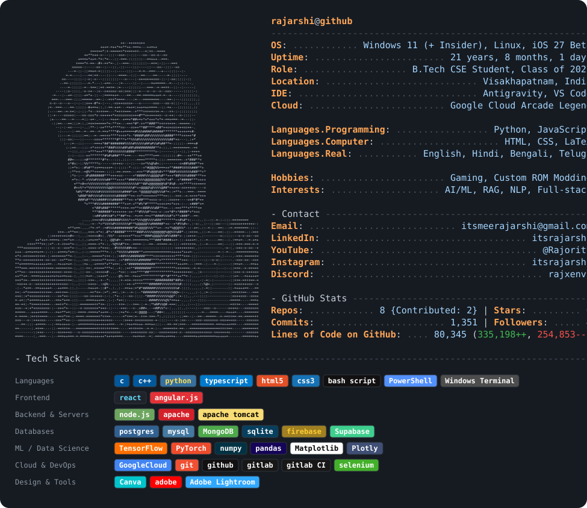

  

**About Me**

B.Tech Computer Science & Engineering student at GITAM University, Visakhapatnam (Class of 2027).
Currently focused on AI/ML systems, full-stack development, and scalable infrastructure design.

- Working on AI-driven projects tackling real-world engineering problems
- Exploring Deep Learning, NLP, and distributed system design
- Open to collaborating on Machine Learning, AI research, and open-source initiatives
- Ask me about Python, DSA, AI/ML concepts, and Git workflows
- Google Cloud Arcade Legend — certified across GCP, Kubernetes, BigQuery, and ML

**Tech Stack**

Languages 

Frontend 

Backend & Servers 

Databases 

ML / Data Science 

Cloud & DevOps 

Design & Tools 

**Achievements**

  

**Connect**

  
  
  
  
  

 

  

 

  

